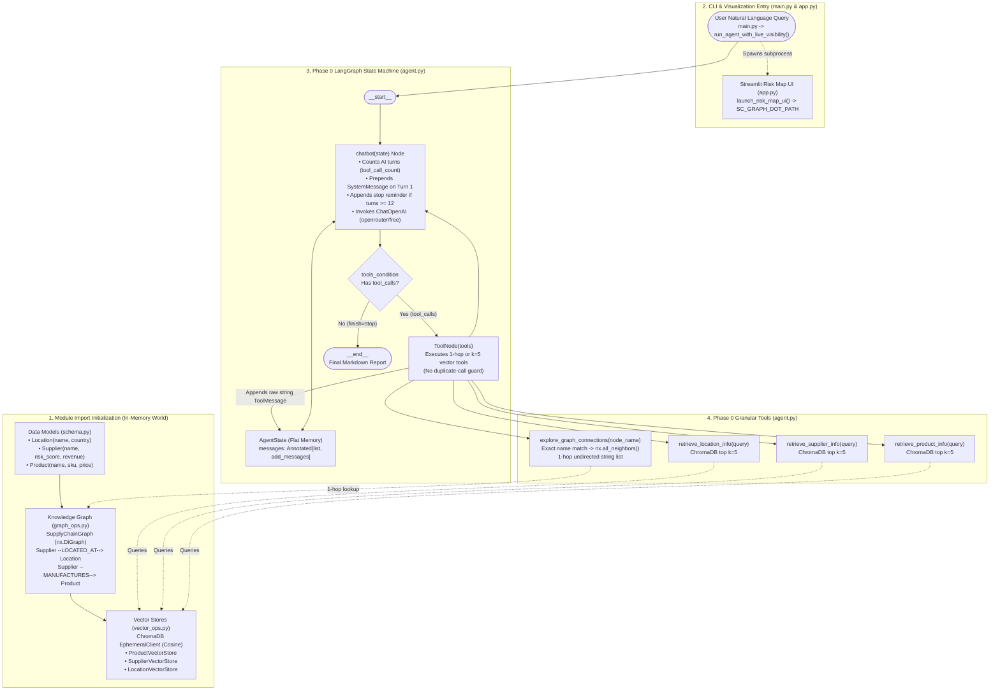

# Phase 0 Architecture & Baseline Deep-Dive Report

> [!NOTE]
> **What is Phase 0?**
> Phase 0 is the **baseline Global Supply Chain Risk Agent** located in the repository root ([`schema.py`](file:///Applications/School/ventures/Global-Supply-Chain-Risk-Agent-GraphRAG-LangGraph-/schema.py), [`graph_ops.py`](file:///Applications/School/ventures/Global-Supply-Chain-Risk-Agent-GraphRAG-LangGraph-/graph_ops.py), [`vector_ops.py`](file:///Applications/School/ventures/Global-Supply-Chain-Risk-Agent-GraphRAG-LangGraph-/vector_ops.py), [`graph_viz.py`](file:///Applications/School/ventures/Global-Supply-Chain-Risk-Agent-GraphRAG-LangGraph-/graph_viz.py), [`app.py`](file:///Applications/School/ventures/Global-Supply-Chain-Risk-Agent-GraphRAG-LangGraph-/app.py), [`agent.py`](file:///Applications/School/ventures/Global-Supply-Chain-Risk-Agent-GraphRAG-LangGraph-/agent.py), and [`main.py`](file:///Applications/School/ventures/Global-Supply-Chain-Risk-Agent-GraphRAG-LangGraph-/main.py)) prior to the multi-hop GraphRAG, structured `AgentState`, and CRAG verification upgrades in [`agent_phase1.py`](file:///Applications/School/ventures/Global-Supply-Chain-Risk-Agent-GraphRAG-LangGraph-/agentic_robustness_review/agent_phase1.py).

---

## 1. Phase 0 End-to-End Agent Architecture Diagram

The diagram below illustrates the complete Phase 0 data pipeline, LangGraph ReAct (`chatbot` $\leftrightarrow$ `tools`) loop, 4 bound tools, and the $1 + L + S$ sequential hop bottleneck when answering a supply chain risk query.

---

## 2. The Story of Phase 0: Step-by-Step Code Walkthrough

### Step 1: Data Schema & Hashing ([`schema.py`](file:///Applications/School/ventures/Global-Supply-Chain-Risk-Agent-GraphRAG-LangGraph-/schema.py#L30-L45))

Phase 0 models the supply chain using three immutable (`@dataclass(frozen=True)`) node types so instances can serve directly as hashable keys in a `networkx.DiGraph`:

- [`Supplier`](file:///Applications/School/ventures/Global-Supply-Chain-Risk-Agent-GraphRAG-LangGraph-/schema.py#L30-L34): Hashed by `name: str`, with non-hash attributes `risk_score: float` ($0.0\text{–}1.0$) and `revenue: float` (`$100K–$1B`).
- [`Product`](file:///Applications/School/ventures/Global-Supply-Chain-Risk-Agent-GraphRAG-LangGraph-/schema.py#L36-L40): Hashed by `sku: str`, with non-hash attributes `name: str` and `price: float`. *(Note: `category` is not stored on `Product` in Phase 0).*
- [`Location`](file:///Applications/School/ventures/Global-Supply-Chain-Risk-Agent-GraphRAG-LangGraph-/schema.py#L42-L45): Hashed by the tuple `(name, country)`.

### Step 2: Synthetic World & Directed Knowledge Graph ([`graph_ops.py`](file:///Applications/School/ventures/Global-Supply-Chain-Risk-Agent-GraphRAG-LangGraph-/graph_ops.py#L40-L305))

When [`SupplyChainGraph.generate_data()`](file:///Applications/School/ventures/Global-Supply-Chain-Risk-Agent-GraphRAG-LangGraph-/graph_ops.py#L290-L305) runs on import, it builds an in-memory `nx.DiGraph()` in three stages:

1. **Locations ([`generate_locations`](file:///Applications/School/ventures/Global-Supply-Chain-Risk-Agent-GraphRAG-LangGraph-/graph_ops.py#L92-L174))**: Loops 20–30 times (`random.randint(20, 30)`) to sample realistic ports, warehouses, and factories across 18 countries (e.g., `Port of Shanghai`, `San Diego Factory`), deduplicating any repeated `(name, country)` pairs before adding them to the graph.
2. **Suppliers ([`generate_suppliers`](file:///Applications/School/ventures/Global-Supply-Chain-Risk-Agent-GraphRAG-LangGraph-/graph_ops.py#L176-L197))**: Creates 1–3 suppliers per location and adds a directed edge:
   $$
   \text{Supplier} \xrightarrow{\text{LOCATED\_AT}} \text{Location}
   $$
3. **Products ([`generate_products`](file:///Applications/School/ventures/Global-Supply-Chain-Risk-Agent-GraphRAG-LangGraph-/graph_ops.py#L199-L288))**: Creates 1–3 products per supplier across 6 categories (`Electronics`, `Automotive`, `Pharmaceutical`, `Industrial`, `Packaging`, `Energy`) and adds a directed edge:
   $$
   \text{Supplier} \xrightarrow{\text{MANUFACTURES}} \text{Product}
   $$

### Step 3: Semantic Vector Indexing ([`vector_ops.py`](file:///Applications/School/ventures/Global-Supply-Chain-Risk-Agent-GraphRAG-LangGraph-/vector_ops.py#L38-L349))

Because [`SupplyChainGraph.get_node_by_name()`](file:///Applications/School/ventures/Global-Supply-Chain-Risk-Agent-GraphRAG-LangGraph-/graph_ops.py#L80-L90) only performs exact string equality (`node.name == name`), Phase 0 indexes all nodes into three in-memory ChromaDB collections (`chromadb.EphemeralClient()`, cosine distance):

- [`ProductVectorStore`](file:///Applications/School/ventures/Global-Supply-Chain-Risk-Agent-GraphRAG-LangGraph-/vector_ops.py#L38-L110): Embeds `product.name` (ID: `sku`), default query limit `k=5`.
- [`SupplierVectorStore`](file:///Applications/School/ventures/Global-Supply-Chain-Risk-Agent-GraphRAG-LangGraph-/vector_ops.py#L157-L229): Embeds `supplier.name` (ID: `name`), default query limit `k=5`.
- [`LocationVectorStore`](file:///Applications/School/ventures/Global-Supply-Chain-Risk-Agent-GraphRAG-LangGraph-/vector_ops.py#L255-L329): Embeds `f"{location.name} {location.country}"` (ID: `name::country`), default query limit `k=5`.

### Step 4: Phase 0 Agent Brain, State, & Tools ([`agent.py`](file:///Applications/School/ventures/Global-Supply-Chain-Risk-Agent-GraphRAG-LangGraph-/agent.py#L65-L338))

1. **Flat State ([`AgentState`](file:///Applications/School/ventures/Global-Supply-Chain-Risk-Agent-GraphRAG-LangGraph-/agent.py#L249-L250))**: Stores only `messages: Annotated[list, add_messages]`. No canonical entities, visited-node sets, or deterministic sums are persisted outside raw message text.
2. **Four Granular Tools ([`agent.py#L80-L216`](file:///Applications/School/ventures/Global-Supply-Chain-Risk-Agent-GraphRAG-LangGraph-/agent.py#L80-L216))**:
   - [`retrieve_product_info`](file:///Applications/School/ventures/Global-Supply-Chain-Risk-Agent-GraphRAG-LangGraph-/agent.py#L80-L98), [`retrieve_supplier_info`](file:///Applications/School/ventures/Global-Supply-Chain-Risk-Agent-GraphRAG-LangGraph-/agent.py#L101-L122), [`retrieve_location_info`](file:///Applications/School/ventures/Global-Supply-Chain-Risk-Agent-GraphRAG-LangGraph-/agent.py#L125-L147): Each hardcodes `k=5` and returns stringified dataclass representations (`[str(obj)]`).
   - [`explore_graph_connections(node_name)`](file:///Applications/School/ventures/Global-Supply-Chain-Risk-Agent-GraphRAG-LangGraph-/agent.py#L149-L216): Calls `graph_db.get_node_by_name(node_name)` (with the semantic fallback block commented out at [`lines 171–191`](file:///Applications/School/ventures/Global-Supply-Chain-Risk-Agent-GraphRAG-LangGraph-/agent.py#L171-L191)) and returns 1-hop neighbors via `nx.all_neighbors(graph_db.graph, found_node)` as `[str(neighbor) for neighbor in neighbors]`.
3. **ReAct Loop ([`chatbot`](file:///Applications/School/ventures/Global-Supply-Chain-Risk-Agent-GraphRAG-LangGraph-/agent.py#L298-L338))**:
   - Connects `__start__ -> chatbot -> tools_condition -> (tools | __end__)` and `tools -> chatbot`.
   - Uses `ChatOpenAI` pointed at OpenRouter (`openrouter/free` at [`lines 281–292`](file:///Applications/School/ventures/Global-Supply-Chain-Risk-Agent-GraphRAG-LangGraph-/agent.py#L281-L292)).

### Step 5: Execution Stream, Telemetry, & Visual UI ([`main.py`](file:///Applications/School/ventures/Global-Supply-Chain-Risk-Agent-GraphRAG-LangGraph-/main.py#L161-L430) & [`app.py`](file:///Applications/School/ventures/Global-Supply-Chain-Risk-Agent-GraphRAG-LangGraph-/app.py#L48-L76))

- [`launch_risk_map_ui()`](file:///Applications/School/ventures/Global-Supply-Chain-Risk-Agent-GraphRAG-LangGraph-/agent.py#L219-L245) serializes the active `graph_db` via [`build_supply_chain_graphviz`](file:///Applications/School/ventures/Global-Supply-Chain-Risk-Agent-GraphRAG-LangGraph-/graph_viz.py#L16-L58) to a temporary `.dot` file (`SC_GRAPH_DOT_PATH`) and launches [`app.py`](file:///Applications/School/ventures/Global-Supply-Chain-Risk-Agent-GraphRAG-LangGraph-/app.py#L64-L74) in Streamlit.
- [`run_agent_with_live_visibility()`](file:///Applications/School/ventures/Global-Supply-Chain-Risk-Agent-GraphRAG-LangGraph-/main.py#L161-L231) streams `agent.stream(..., stream_mode="values")` in real time, and [`print_conversation_flow()`](file:///Applications/School/ventures/Global-Supply-Chain-Risk-Agent-GraphRAG-LangGraph-/main.py#L282-L403) links every `ToolMessage` back to its originating `AIMessage` tool call, extracts `<think>` / `reasoning_content` traces, and summarizes runtime, token usage, and routed models.

---

## 3. Why Phase 0 Struggled on Complex Queries (The 6 Code-Level Bottlenecks)

When stress-tested across 3 end-to-end runs in [`agent_eval.py`](file:///Applications/School/ventures/Global-Supply-Chain-Risk-Agent-GraphRAG-LangGraph-/agentic_robustness_review/agent_eval.py), Phase 0 completed all runs without crashing, but exhibited six structural bottlenecks that motivated Phases 1–3:

| #           | Bottleneck                                                  | Phase 0 Code Location                                                                                                                                                                                                                                                                                                                                         | Empirical Impact in 3-Run Stress Test                                                                                                     | How Phases 1–3 Solved It                                                                                                                                                                                                                                                                                                                                                                                       |
| :---------- | :---------------------------------------------------------- | :------------------------------------------------------------------------------------------------------------------------------------------------------------------------------------------------------------------------------------------------------------------------------------------------------------------------------------------------------------ | :---------------------------------------------------------------------------------------------------------------------------------------- | :-------------------------------------------------------------------------------------------------------------------------------------------------------------------------------------------------------------------------------------------------------------------------------------------------------------------------------------------------------------------------------------------------------------- |
| **1** | **$1 + L + S$ Sequential 1-Hop Traversal**          | [`agent.py#L201`](file:///Applications/School/ventures/Global-Supply-Chain-Risk-Agent-GraphRAG-LangGraph-/agent.py#L201) (`nx.all_neighbors`)                                                                                                                                                                                                              | Traversing 4 China locations + 8 suppliers in Run 2 required **19 tool calls across 7 LLM turns** (`34.22s`).                     | **Phase 1**: [`analyze_location_blast_radius`](file:///Applications/School/ventures/Global-Supply-Chain-Risk-Agent-GraphRAG-LangGraph-/agentic_robustness_review/agent_phase1.py#L283-L550) traverses all 2 hops in **1 tool call** ($<1\text{ ms}$).                                                                                                                                            |
| **2** | **Hardcoded `k=5` Vector Ceiling**                  | [`agent.py#L92`](file:///Applications/School/ventures/Global-Supply-Chain-Risk-Agent-GraphRAG-LangGraph-/agent.py#L92), [`#L114`](file:///Applications/School/ventures/Global-Supply-Chain-Risk-Agent-GraphRAG-LangGraph-/agent.py#L114), [`#L139`](file:///Applications/School/ventures/Global-Supply-Chain-Risk-Agent-GraphRAG-LangGraph-/agent.py#L139) | Run 3 missed **3 of 8 (37.5%) pharmaceutical products**, including the highest-risk supplier (`0.90`).                            | **Phase 1**: [`audit_products_and_upstream_suppliers`](file:///Applications/School/ventures/Global-Supply-Chain-Risk-Agent-GraphRAG-LangGraph-/agentic_robustness_review/agent_phase1.py#L553-L700) uses catalog matching + `k=25` (**100% recall**).                                                                                                                                            |
| **3** | **LLM Mental Arithmetic**                             | No Python sum in [`agent.py`](file:///Applications/School/ventures/Global-Supply-Chain-Risk-Agent-GraphRAG-LangGraph-/agent.py)                                                                                                                                                                                                                              | Summing 8 supplier revenues in Run 2 produced a **`$300.4M` (`7.6%`) math error** (`$3.66B` vs `$3.96B`).                   | **Phase 1 & 2**: Exact Python rollups in `deterministic_summary_metrics` (**`$0.00` error**).                                                                                                                                                                                                                                                                                                   |
| **4** | **Flat `messages` Memory & No Duplicate Guard**     | [`agent.py#L249-L250`](file:///Applications/School/ventures/Global-Supply-Chain-Risk-Agent-GraphRAG-LangGraph-/agent.py#L249-L250), [`#L331`](file:///Applications/School/ventures/Global-Supply-Chain-Risk-Agent-GraphRAG-LangGraph-/agent.py#L331)                                                                                                        | When `openrouter/free` switched models between turns in Run 1, 9 of 15 tool calls (**60%**) were redundant re-queries.            | **Phase 2**: Structured [`AgentState`](file:///Applications/School/ventures/Global-Supply-Chain-Risk-Agent-GraphRAG-LangGraph-/agentic_robustness_review/agent_phase1.py#L789-L815) + [`stateful_tool_node`](file:///Applications/School/ventures/Global-Supply-Chain-Risk-Agent-GraphRAG-LangGraph-/agentic_robustness_review/agent_phase1.py#L1175-L1467) blocks duplicate and 1-hop redundant calls. |
| **5** | **AI-Turn vs. Tool-Invocation Counter Bug**           | [`agent.py#L304`](file:///Applications/School/ventures/Global-Supply-Chain-Risk-Agent-GraphRAG-LangGraph-/agent.py#L304)                                                                                                                                                                                                                                     | Counted AI messages with `tool_calls` instead of `sum(len(msg.tool_calls))`, undercounting parallel tool calls.                       | **Phase 1**: [`chatbot`](file:///Applications/School/ventures/Global-Supply-Chain-Risk-Agent-GraphRAG-LangGraph-/agentic_robustness_review/agent_phase1.py#L1635-L1762) tracks both `total_tool_invocations` and `ai_tool_turns`.                                                                                                                                                                    |
| **6** | **Unverified Exit to `__end__` (Dropped Entities)** | [`agent.py#L335`](file:///Applications/School/ventures/Global-Supply-Chain-Risk-Agent-GraphRAG-LangGraph-/agent.py#L335) (`tools_condition`)                                                                                                                                                                                                               | Run 2 fetched all 16 products in `ToolMessage`s but silently omitted 3 products from `Wilson, Henry and Freeman` in the final report. | **Phase 3**: [`verify_and_reflect`](file:///Applications/School/ventures/Global-Supply-Chain-Risk-Agent-GraphRAG-LangGraph-/agentic_robustness_review/agent_phase1.py#L1772-L1936) audits every discovered entity and revenue total before allowing `__end__`.                                                                                                                                         |
